# 🏗️ Architecture Technique et Diagramme de Flux — JARVIS v3.0

Ce document détaille l'architecture globale, l'organisation modulaire et les flux d'exécution du projet **JARVIS**, en décrivant le fonctionnement hybride entre l'environnement **WSL (Linux)** et le système hôte **Windows**.

---

## 📊 Diagramme d'Architecture et des Flux

Le schéma ci-dessous illustre la circulation des données à travers les différentes couches du système, depuis les interfaces d'interaction utilisateur jusqu'aux services externes et l'OS hôte :

```mermaid
flowchart TD

subgraph group_interaction["User interaction"]
  node_browser["Web interface<br/>[index.html]"]
  node_server["Flask and Socket.IO<br/>[app.py]"]
  node_keyboard["Keyboard mode<br/>[main_keyboard.py]"]
  node_ears["Speech recognition<br/>[ears.py]"]
  node_mouth["Speech output<br/>[mouth.py]"]
end

subgraph group_reasoning["Reasoning and agents"]
  node_brain["Request processor<br/>[processor.py]"]
  node_agent_router["Agent router<br/>[hub.py]"]
  node_agent_coordination["Agent coordination<br/>[agents_hub.py]"]
  node_agents["Specialist agents"]
end

subgraph group_capabilities["Assistant capabilities"]
  node_memory[("Persistent memory<br/>[memory.py]")]
  node_commands["System commands<br/>[actions.py]"]
  node_weather["Weather lookup<br/>[tools.py]"]
  node_web_search["Web search<br/>[internet.py]"]
  node_email["Email retrieval<br/>[email_manager.py]"]
  node_logs["Log analysis<br/>[log_analyzer.py]"]
  node_code["Code reading<br/>[code_reader.py]"]
end

subgraph group_system["System integration"]
  node_stats["Machine statistics<br/>[system_stats.py]"]
end

subgraph group_services["External services"]
  node_ollama["Ollama LLM"]
  node_windows["Windows host"]
  node_open_meteo["Open-Meteo"]
  node_outlook["Outlook IMAP"]
end

node_user(("User"))

node_user -->|"uses"| node_browser
node_browser -->|"sends events"| node_server
node_server -->|"streams updates"| node_browser
node_user -->|"enters text"| node_keyboard
node_server -->|"captures speech"| node_ears
node_server -->|"processes requests"| node_brain
node_keyboard -->|"processes text"| node_brain
node_brain -->|"returns speech"| node_mouth
node_brain -->|"queries model"| node_ollama
node_brain -->|"delegates tasks"| node_agent_router
node_agent_router -.->|"dispatches tasks"| node_agents
node_brain -->|"reads and updates"| node_memory
node_brain -->|"executes commands"| node_commands
node_brain -->|"requests weather"| node_weather
node_weather -->|"fetches forecasts"| node_open_meteo
node_brain -->|"requests search"| node_web_search
node_brain -->|"retrieves messages"| node_email
node_email -->|"reads mailbox"| node_outlook
node_brain -->|"requests log analysis"| node_logs
node_agents -->|"uses code reader"| node_code
node_brain -->|"requests metrics"| node_stats
node_server -->|"broadcasts telemetry"| node_stats
node_commands -->|"controls host"| node_windows
node_ears -->|"records audio"| node_windows

click node_browser "https://github.com/mathieu7483/jarvis/blob/main/templates/index.html"
click node_server "https://github.com/mathieu7483/jarvis/blob/main/app.py"
click node_keyboard "https://github.com/mathieu7483/jarvis/blob/main/main_keyboard.py"
click node_ears "https://github.com/mathieu7483/jarvis/blob/main/app/speech/ears.py"
click node_mouth "https://github.com/mathieu7483/jarvis/blob/main/app/speech/mouth.py"
click node_brain "https://github.com/mathieu7483/jarvis/blob/main/app/core/processor.py"
click node_agent_router "https://github.com/mathieu7483/jarvis/blob/main/app/agents/hub.py"
click node_agent_coordination "https://github.com/mathieu7483/jarvis/blob/main/app/core/agents_hub.py"
click node_agents "https://github.com/mathieu7483/jarvis/tree/main/app/agents"
click node_memory "https://github.com/mathieu7483/jarvis/blob/main/app/core/memory.py"
click node_commands "https://github.com/mathieu7483/jarvis/blob/main/app/actions.py"
click node_weather "https://github.com/mathieu7483/jarvis/blob/main/app/core/tools.py"
click node_web_search "https://github.com/mathieu7483/jarvis/blob/main/app/core/internet.py"
click node_email "https://github.com/mathieu7483/jarvis/blob/main/app/core/email_manager.py"
click node_logs "https://github.com/mathieu7483/jarvis/blob/main/app/core/log_analyzer.py"
click node_code "https://github.com/mathieu7483/jarvis/blob/main/app/core/code_reader.py"
click node_stats "https://github.com/mathieu7483/jarvis/blob/main/app/core/system_stats.py"

classDef toneNeutral fill:#f8fafc,stroke:#334155,stroke-width:1.5px,color:#0f172a
classDef toneBlue fill:#dbeafe,stroke:#2563eb,stroke-width:1.5px,color:#172554
classDef toneAmber fill:#fef3c7,stroke:#d97706,stroke-width:1.5px,color:#78350f
classDef toneMint fill:#dcfce7,stroke:#16a34a,stroke-width:1.5px,color:#14532d
classDef toneRose fill:#ffe4e6,stroke:#e11d48,stroke-width:1.5px,color:#881337
classDef toneIndigo fill:#e0e7ff,stroke:#4f46e5,stroke-width:1.5px,color:#312e81
classDef toneTeal fill:#ccfbf1,stroke:#0f766e,stroke-width:1.5px,color:#134e4a
class node_browser,node_server,node_keyboard,node_ears,node_mouth,node_user toneBlue
class node_brain,node_agent_router,node_agent_coordination,node_agents toneAmber
class node_memory,node_commands,node_weather,node_web_search,node_email,node_logs,node_code toneMint
class node_stats toneRose
class node_ollama,node_windows,node_open_meteo,node_outlook toneIndigo
```

---

## 🛠️ Description des Couches de l'Architecture

### 1. Couche Interaction Utilisateur (`User Interaction`)
- **Interface Web HUD (`index.html`)** : Interface visuelle temps réel développée avec Three.js (visualiseur 3D synaptique) et alimentée par WebSockets (`Flask-SocketIO`).
- **Saisie Clavier Dédiée (`main_keyboard.py`)** : Point d'entrée textuel CLI alternatif exécutable indépendamment.
- **Pipeline Audio (`app/speech/`)** :
  - **`ears.py`** : Captation du flux audio et transcription automatique par Faster-Whisper.
  - **`mouth.py`** : Restitution vocale fluide via pyttsx3.

### 2. Couche Raisonnement & Multi-Agents (`Reasoning and Agents`)
- **Processeur Central (`app/core/processor.py`)** : Moteur d'analyse sémantique, classification d'intentions et injection de contexte historique/temporel.
- **Coordinateurs & Routage (`app/core/agents_hub.py` & `app/agents/hub.py`)** : Orchestrent et dirigent les requêtes complexes vers des personnalités/agents spécialisés (`app/agents/`) :
  - `friday.py` : Organisation, agenda et rappels.
  - `tars.py` : Logique formelle, calculs et sciences.
  - `ultron.py` : Sécurité, audits et opérations avancées.
  - `skynet.py` : Réseau et supervision domotique.
  - `mother.py` / `veronica.py` : Protocoles de sécurité et supervision.
  - `david.py` / `sonny.py` : Analyse comportementale et dialogue.

### 3. Couche Capacités & Outillage (`Assistant Capabilities`)
Regroupe les modules d'exécution autonome situés dans `app/core/` :
- **`code_reader.py`** : Inspection et analyse syntaxique de fichiers de code source.
- **`log_analyzer.py`** : Analyse de journaux d'erreurs et de fichiers `.log` pour le diagnostic système.
- **`tools.py`** : Fonctions utilitaires, dont les requêtes météorologiques.
- **`memory.py`** : Persistance de l'état, faits appris et profil utilisateur (`jarvis_memory.json`).
- **`email_manager.py`** : Lecture et structuration des courriels (IMAP).
- **`internet.py`** : Effectue des recherches et requêtes web externes.
- **`actions.py`** : Exécuteur de commandes système sur l'hôte Windows à l'aide de scripts éphémères PowerShell.

### 4. Couche Intégration Système & Services Externes
- **`system_stats.py`** : Surveillance matérielle en continu (charge CPU, VRAM GPU, mémoire disponible).
- **Inférence LLM** : Communication via API REST avec le serveur **Ollama** (`llama3.1:8b`) fonctionnant sur l'hôte Windows.
- **Services Web Tierces** : API météo (Open-Meteo), serveurs de messagerie (Outlook IMAP) et pont inter-systèmes WSL/Windows.